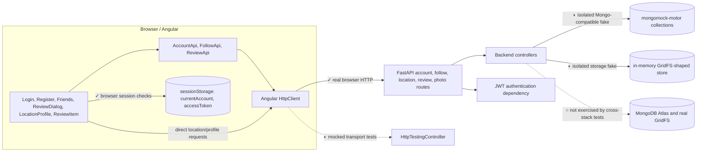

# Test Plan: Beli for Vanderbilt | Sprint 3 | Owner: Helen Wu

## Scope

Testing is limited to these user stories:

1. Create an account with email, username, and password.
2. Log in with username and password.
3. Upload a photo with a 1–5 rating, review text, and date.
4. Edit my own rating and review.
5. Delete my own rating and review.
6. Show an updated review in the browser within five seconds.

Account deletion, follows, dining-location CRUD, search, hours, meal filters, and layout are outside this sprint's test work.

The six numbers above are **Sprint 3 acceptance-story IDs**, not GitHub issue numbers or IDs from the original 24-story project backlog. Their cross-reference is: Sprint 3 story 1 → original story 1; 2 → 2; 3 → 7; 4 → 11; 5 → 12; and 6 → 23. Repository regression suites also exercise features outside this Sprint 3 scope; those tests do not expand the six-story acceptance scope.

## Baseline (October 8, 2026)

Command:

```bash
backend/.venv/bin/python -m pytest \
  --cov=backend \
  --cov-branch \
  --cov-report=term-missing
```

| Measure | Result |
| --- | ---: |
| Tests | 51 passed |
| Combined coverage | 89.63% |
| Statement coverage | 91.28% (827 of 906) |
| Branch coverage | 63.79% (37 of 58) |
| Failed, skipped | 0, 0 |

This is a **historical repository-wide backend result**, not the six-story result. It includes follow and location code because the command uses `--cov=backend`. Preserve it as the October 8 baseline; it is not the current result and is not directly comparable to the current CI metric described below.

The following per-module figures are retained as part of that original baseline snapshot; they are not current coverage:

| Module | Combined coverage |
| --- | ---: |
| `backend/controllers/review.py` | 100% |
| `backend/models/review.py` | 100% |
| `backend/routes/review.py` | 100% |
| `backend/controllers/user.py` | 89% |
| `backend/models/user.py` | 100% |
| `backend/routes/user.py` | 90% |

High line coverage does not prove the user stories. At the time of this historical baseline, tests did not establish a 1–5 limit, photo transfer, author-only writes, or the five-second browser update. The current test evidence and the still-unmet requirements are separated below.

## Current execution snapshot (October 18, 2026)

| Suite / measure | Result | Evidence and interpretation |
| --- | ---: | --- |
| Angular unit tests | 117 passed | `npm run test:unit`; 14 test files. |
| Backend pytest | 130 passed | Full `backend/tests/` suite; one Starlette/httpx deprecation warning. |
| Angular statements / branches / functions / lines | 74.16% / 68.33% / 68.47% / 78.40% | V8 coverage via `npm run test:coverage`. |
| Backend CI coverage gate | 83.58% latest rerun; 83.77% in the earlier Phase D run | pytest-cov total reported with branch measurement enabled by `.coveragerc`; this is the gate's combined coverage result, not a separate statement or branch percentage. Both runs passed the 50% gate; the latest rerun included 130 passing tests. |
| Playwright cross-stack | 1 passed | Local test against the isolated FastAPI app; GitHub-hosted execution is pending. |
| Five-second create-to-visible timing | 183 ms | One local Playwright run; see the timing section. |

**Evidence provenance:** This plan is being updated on `helen/test-plan` at `698ee94`. The Phase B–D implementation and tests were inspected in the separate `sara/frontend/ratings-reviews-photos` worktree at `e8aa7db`; at this update, those changes are staged, unstaged, or untracked there and are not committed or merged into this plan branch. The references below document that local evidence and do not imply that the test files or CI changes are present on `helen/test-plan`. The refreshed `origin/main` is `de553c2`; no merge or rebase was performed.

## Targets

The following were the original Sprint 3 targets. The current workflow does not enforce the two module-level branch targets separately; it enforces a repository-wide pytest-cov gate of 50% using the branch-enabled configuration. Do not treat the targets below as verified current results.

- At least 70% branch coverage across the account and review backend modules.
- At least 85% branch coverage in review model, controller, and route code.
- Every acceptance check below passes.
- No skipped tests for the six stories.
- The five-second requirement uses a measured clock, not a manual observation.

## Acceptance checks

| Sprint 3 story | Priority | Current status | Evidence and remaining acceptance gap |
| --- | --- | --- | --- |
| 1. Create an account with email, username, and password | P0 | Complete in local tests | Backend validation, duplicates, and response fields are tested; Playwright registers an account through Angular and FastAPI. |
| 2. Log in with username and password | P0 | Complete in local tests | Valid and invalid credentials and JWT issuance/storage are tested. |
| 3. Upload a photo with a 1–5 rating, review text, and date | P0 | Partial | Authenticated upload, photo attachment, retrieval, and display pass locally. The UI uses 1–10 and backend review validation accepts integers without a range limit; the historical 1–5 acceptance condition is unmet. |
| 4. Edit my own rating and review | P0 | Partial | Browser flow edits a review and photo references are ownership-checked. Text-only review updates remain unauthenticated in the backend, so author-only authorization is unmet. |
| 5. Delete my own rating and review | P0 | Partial | Browser flow deletes a review. The backend delete route remains unauthenticated, so author-only authorization is unmet. |
| 6. Show an updated review in the browser within five seconds | P0 | Locally measured; not production-verified | One local Playwright create flow measured 183 ms from successful API response to visible review, below 5,000 ms. Edit/delete are exercised but not separately timed; hosted and production performance remain unverified. |

“Complete in local tests” describes tested behavior in the current feature worktree, not a claim that the changes are merged or that production behavior has been verified.

## Test cases and implemented evidence

The acceptance checks below originated in the Sprint 3 plan. Current test evidence is listed in the EP/EV and BVA inventory later in this document. Requirements contradicted by the current implementation are retained as gaps rather than treated as passing tests.

### Account creation and login — acceptance requirements retained

- Create an account, then query the fake MongoDB collection and check the normalized email, unique username, and password hash.
- Submit malformed email, missing username, and passwords shorter than the contract permits.
- Create duplicate-email and duplicate-username records and check for `409 Conflict`.
- Log in with the saved username and password.
- Check wrong-password and unknown-user responses for the same status and message.
- Check that account responses omit `password` and `password_hash`.

### Photo review creation — original acceptance requirements retained

- Submit one photo, rating `1`, review text, and an ISO 8601 date.
- Repeat with rating `5`.
- Reject ratings `0`, `6`, and `2.5`.
- Reject missing photo, rating, review text, or date.
- Check that the stored review points to the stored photo and keeps the submitted date.
- Check photo-storage failure: no partial review record may remain.

### Review ownership — original acceptance requirements retained

- Update rating and text as the author.
- Try the same update as another account and expect `403 Forbidden` with no database change.
- Try to change author, location, creation date, or photo owner and expect rejection or ignored immutable fields, according to the API contract.
- Delete as the author and verify the record is gone.
- Delete as another account and expect `403 Forbidden`; verify the record remains.
- Request update or delete for an unknown review and expect `404 Not Found`.

### Five-second browser update — original acceptance requirements retained

- After create succeeds, check that the new review, count, and average appear before a 5,000 ms deadline.
- After edit succeeds, check that the new rating, text, and average appear before the deadline.
- After delete succeeds, check that the review disappears and the count and average change before the deadline.
- Hold the API response open and check that the browser does not display an unconfirmed change.
- Return an API error and check that the prior review state remains visible.

The browser measurement uses a real monotonic timer. Component tests do not establish the end-to-end five-second requirement.

## Integration seam map and strategy



Legend: **✓** real Angular/browser-to-FastAPI behavior; **◐** tested with mocked HTTP or persistence dependencies; **○** not tested at that seam. The suite is sandwich-style: Angular and backend unit/route tests cover the inner layers, while Playwright exercises the browser-to-API path; persistence in that cross-stack path is intentionally replaced by fakes.

The Phase B `HttpTestingController` tests verify request construction and mocked response handling; they are not real frontend/backend integration tests. The Playwright test uses a real browser and HTTP requests to FastAPI, but `backend/integration_test_server.py` replaces persistence and GridFS with process-local in-memory fakes. It does not verify real Atlas connectivity, MongoDB server semantics, or production data.

## Real browser-to-FastAPI test

`frontend/e2e/cross-stack.spec.ts` contains the test **“Angular completes real account, location, review, friends, and photo HTTP flows against FastAPI.”** It covers registration; valid and invalid login; JWT fields and session storage; location and review loading; Discover search and follow/unfollow; review creation, editing, and deletion; aggregate updates; expired-token rejection; authenticated photo upload and retrieval; review/gallery photo display; and public-profile navigation.

The app uses a real browser, Angular frontend, real HTTP communication, and the isolated `backend/integration_test_server.py` FastAPI app. The fake database and GridFS data live only for the server process and never connect to Atlas. `FollowApi` still targets `http://localhost:8000`; the Playwright test forwards that request to its test server at `127.0.0.1:18000`, so production Follow API URL configuration is not verified.

## Five-second acceptance measurement

In the Playwright test above, `process.hrtime.bigint()` is captured immediately after the successful FastAPI review-create response; the test then waits for the review text to become visible and measures elapsed time. The threshold is **less than 5,000 ms**. The latest recorded local run was **183 ms** (one run). It passes locally but does not guarantee production performance, and the test does not separately time edit and delete updates.

## Known contract gaps

- **Rating validation:** Historical Sprint 3 story 3 specifies a 1–5 rating. Angular currently accepts 1–10; backend review validation accepts integer ratings without a range restriction. Tests characterize current behavior; the product contract was not changed.
- **Review authorization:** Text-only review editing and deletion remain unauthenticated. `backend/tests/test_reviews.py::test_review_text_update_and_delete_are_currently_unauthenticated` characterizes this existing behavior. Photo-reference changes have separate bearer-token and ownership checks, but this does not make all review operations author-authorized.
- **Follow API URL:** `FollowApi` uses hardcoded `http://localhost:8000`. Playwright forwards its calls to the isolated test server; production API URL compatibility is not verified.
- **JWT lifetime and logout:** Access tokens expire after 15 minutes. Logout clears browser session state but does not revoke an issued JWT server-side.
- **Persistence:** The browser integration test uses an in-memory Mongo-compatible fixture and fake GridFS, not MongoDB Atlas or real GridFS.
- **CI status:** The updated workflow has not yet completed on a GitHub-hosted runner.
- **Dependency security:** npm audit reported high-severity transitive advisories for `http-cache-semantics` through 4.2.0 and `source-map-js` before 1.2.2. They are not resolved by this test-plan update.
- **Build warnings:** The Angular build passes but reports that the initial bundle and `friends.css` exceed configured size budgets.

## Not testing

- Account deletion: absent from the selected stories.
- Follow relationships and friends' reviews: outside the six-story acceptance scope, though the repository regression suites and Playwright flow exercise follow/unfollow.
- Dining-location create, update, delete, search, and hours: only the location page's review refresh is in scope.
- Meal-type filtering: absent from the selected stories.
- MongoDB Atlas availability, replication, backups, and real GridFS behavior: not covered by the in-memory integration server.
- Angular Material internals and pixel matching: test application state and visible output.

## EP/EV and BVA inventory

The following are implemented test cases, not proposed tests. EP/EV partitions valid and invalid inputs; BVA checks values around limits. Backend and Angular tests are isolated from Atlas. Ratings below describe the actual 1–10 UI/backend behavior and do not assert the historical 1–5 contract.

| Test ID | Feature / Sprint story | Technique and input boundary | Expected / characterized result | Automated test |
| --- | --- | --- | --- | --- |
| EP-01 | Registration / 1 | Valid registration; malformed email, invalid account type, duplicate username/email | Valid account is created; invalid or duplicate values are rejected | `backend/tests/test_user_models.py::test_registration_rejects_malformed_email_and_invalid_account_type`; `backend/tests/test_account_api.py::test_registration_rejects_duplicate_username_and_email` |
| BVA-01 | Password / 1 | Password at minimum, above minimum, and one below minimum | At/above minimum accepted; below minimum rejected | `backend/tests/test_user_models.py::test_registration_accepts_password_at_and_above_minimum_length`; `backend/tests/test_user_models.py::test_registration_rejects_password_below_minimum_length`; `backend/tests/test_account_api.py::test_registration_rejects_invalid_fields_and_password_below_minimum` |
| EP-02 | Login / 2 | Valid credentials, wrong password, unknown username, empty/whitespace required fields | Valid login returns account/token; invalid credential classes are rejected; required blanks rejected | `backend/tests/test_account_api.py::test_user_can_log_in_with_valid_credentials`; `backend/tests/test_account_api.py::test_login_rejects_invalid_credentials`; `backend/tests/test_account_api.py::test_login_rejects_empty_or_whitespace_required_fields` |
| BVA-02 | JWT / 2, 3–5 | Token exp immediately before, exactly at, and after expiration; missing/tampered token | Valid-before accepted; at/after, missing, or tampered tokens rejected | `backend/tests/test_account_api.py::test_jwt_expiration_boundary_is_valid_before_and_invalid_at_or_after`; `backend/tests/test_account_api.py::test_authentication_rejects_tampered_tokens`; `backend/tests/test_account_api.py::test_authentication_rejects_missing_bearer_tokens_and_mock_cookie` |
| BVA-03 | Rating / 3 | UI minimum 1, maximum 10, just outside endpoints, fractional input; backend integer outside UI range | UI accepts integer 1–10 and rejects outside/fractional values; backend characterization confirms it accepts integers without range validation | `frontend/src/app/components/review-dialog/review-dialog.spec.ts::accepts the current 1–10 rating endpoints and rejects values outside them`; `backend/tests/test_reviews.py::test_backend_currently_accepts_integer_ratings_without_range_validation` |
| EP/BVA-04 | Photo upload / 3 | JPEG, PNG, WebP; empty/corrupt/unsupported; byte limit below, exactly at, and one byte above 5 MiB | Supported valid images accepted; invalid images rejected; exactly 5 MiB accepted and above-limit rejected | `backend/tests/test_photo_storage.py::test_processes_supported_formats`; `backend/tests/test_photo_storage.py::test_rejects_empty_corrupt_unsupported_and_oversized_uploads`; `backend/tests/test_photo_storage.py::test_upload_byte_limit_accepts_below_and_exact_limit_rejects_above` |
| BVA-05 | Image dimensions / 3 | Decoded image pixel count around the configured 40-megapixel limit | At/below configured bound follows acceptance; above bound is rejected | `backend/tests/test_photo_storage.py::test_decoded_pixel_limit_boundary` |
| BVA-06 | Review photos / 3 | Photo counts 1, 2, and 3; fourth photo; duplicate IDs | Counts 1–3 accepted; more than three and duplicate IDs rejected | `backend/tests/test_photos.py::test_review_accepts_each_supported_photo_count`; `backend/tests/test_photos.py::test_review_rejects_duplicate_and_more_than_three_photo_ids` |
| EP-03 | Photo authorization / 3–5 | Missing/invalid/expired/tampered bearer token; wrong owner; pending or mismatched photo | Upload/attachment authorization and photo visibility checks reject invalid or mismatched cases | `backend/tests/test_photos.py::test_upload_rejects_missing_invalid_expired_and_tampered_tokens`; `backend/tests/test_photos.py::test_review_rejects_missing_or_other_users_photo`; `backend/tests/test_photos.py::test_photo_is_hidden_when_review_author_does_not_match_owner` |
| BVA-07 | Orphan cleanup / 3–5 | Photo age just below, exactly at, and above 24-hour unreferenced grace period | Below grace retained; at/after eligible only if unreferenced and not claimed/held | `backend/tests/test_photo_cleanup.py::test_grace_period_boundary_is_ineligible_before_and_eligible_at_or_after`; `backend/tests/test_photo_cleanup.py::test_detached_photo_grace_starts_at_unreferenced_since`; `backend/tests/test_photo_cleanup.py::test_existing_claim_and_unknown_status_are_never_candidates` |
| EP-04 | Review authorization / 4–5 | Text-only update/delete requests without authentication | Current unauthenticated behavior is characterized; does not satisfy author-only security requirement | `backend/tests/test_reviews.py::test_review_text_update_and_delete_are_currently_unauthenticated` |

Angular API transport contracts are separately tested with `HttpTestingController` in `frontend/src/app/api/account.api.spec.ts`, `frontend/src/app/api/follow.api.spec.ts`, and `frontend/src/app/api/review.api.spec.ts`. Representative cases include `posts login credentials and preserves JWT response fields`, `updates an encoded relationship id and only sends supplied fields`, `sends a bearer token when creating a review with photos`, and `uploads multipart photo data with bearer authentication`. These verify methods, paths, query/body data, bearer headers where applicable, and mocked responses; they are not live HTTP tests.

## Test data and isolation

- Backend pytest uses isolated fake collections and fake GridFS fixtures; no Atlas URI or student account is used.
- Playwright starts `backend/integration_test_server.py`, which owns process-local `mongomock-motor` collections and an in-memory GridFS-shaped store. Test data disappears when the server exits.
- Angular API unit tests use `HttpTestingController`; no FastAPI server is contacted.
- Never run project seed scripts as part of this plan. No test or CI job may connect to shared Atlas.

## CI/CD verification

`.github/workflows/ci.yml` triggers on pull requests targeting `main` and pushes to `main`. Its `quality-gate` uses Node 22.12 and Python 3.12, installs from the npm lockfile and backend requirements, then runs Ruff, ESLint, TypeScript checks, Angular unit tests and coverage, backend pytest and coverage, the production Angular build, and `npm run test:integration`. Playwright installs Chromium and Linux dependencies. The production Angular build is reused by Playwright; failure screenshots and traces are uploaded as artifacts. The `deploy-staging` job has `needs: quality-gate`, so a failed gate blocks staging deployment.

**Playwright is configured as part of the GitHub Actions quality gate; local validation passed. GitHub-hosted runner verification remains pending.** The Phase D workflow change itself is not yet committed/merged into `helen/test-plan` as of this document update.

## Local test commands

From the repository root, after installing the declared dependencies and Playwright Chromium:

Full backend suite and the CI-equivalent coverage gate:

```bash
python -m pytest --cov=backend --cov-config=.coveragerc \
  --cov-report=term-missing --cov-fail-under=50
```

Frontend unit tests, coverage, typecheck, and lint:

```bash
cd frontend && npm ci
npm run test:unit
npm run test:coverage
npm run typecheck
npm run lint
npx ng build
npx playwright install --with-deps chromium
npm run test:integration
```

Backend lint:

```bash
cd backend
ruff check .
```

The integration command starts its isolated FastAPI and Angular test servers through Playwright configuration; no local `.env` or Atlas credentials are required.

## Entry and exit criteria

**Entry:** dependencies installed from lock/requirements files; backend and frontend test configuration available; no shared database credentials configured in the test process.

**Exit:** all existing unit tests pass without skips; the 50% backend and frontend coverage gates pass; typecheck, ESLint, Ruff, and production build pass; local Playwright cross-stack test passes; `git diff --check` passes. GitHub-hosted workflow verification and production performance are reported separately until actually observed.

## Remaining risks and follow-up

- Decide and implement the rating contract only with product approval; do not infer a change from the historical 1–5 requirement.
- Add backend author authentication to text-only review update and delete before claiming those stories meet author-only authorization.
- Remove the hardcoded Follow API URL in a separate approved change, then remove Playwright request forwarding and verify deployed API configuration.
- Run the updated GitHub Actions workflow on a PR and confirm the quality gate and staging dependency on GitHub.
- Reassess npm advisories and bundle-budget warnings in separate dependency/performance work; this document does not change code or dependencies.
