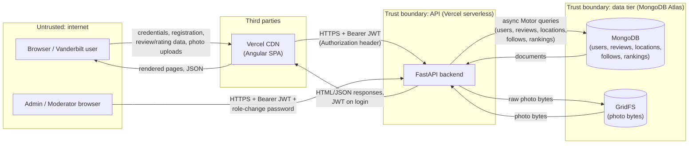

# Threat model -- Group 1 (Beli for Vandy)   (docs/security/threat-model.md)
Last updated: 11/3/2026 · Authors: Ashley Lai, Helen Wu, Terra Jang, Sara Ota · Covers: main @ bb66fc6dd0833e1820075f5cc3820ac7a33e6091 + staging [<url>](https://beli-for-vandy-frontend.vercel.app/login)

## 1. Data-flow diagram (DFD)

## 2. Assets (what an attacker wants)
| Asset | Where it lives | Why it matters |
|-------|----------------|----------------|
| User accounts / sessions | MongoDB users collection; JWT in browser sessionStorage | Account takeover; impersonation of other users |
| Personal data (emails, schedules, ...) | MongoDB users collection | PII exposure; Vanderbilt community members’ info  |
| Admin / moderator role assignments |role field in MongoDB users documents|Privilege escalation; attacker could promote themselves to admin  |
| API Keys and Secrets | Backend .env / Vercel environment variable | Forge valid tokens for any user or admin  |

## 3. STRIDE table (at least 8 rows, across at least 3 boundaries)
| # | Boundary (A -> B) | STRIDE | Asset | Threat (one sentence) | Existing control | Gap? -> Finding ID |
|---|-------------------|--------|-------|-----------------------|------------------|--------------------|
| T1 | Browser -> API | S | API Keys & Secrets | Someone who obtains another user's JWT could impersonate that user until the token expires. | JWT signature and expiration verification. | Check token revocation and exposure risks; open an issue if controls are insufficient.|
| T2 | Browser -> API | T | User Informatino | A user could change the user_id or review ID in a request to try to modify someone else's review. |Backend authentication and review ownership checks reported in current main. | Verify with two test accounts that unauthorized edits/deletes are rejected. |
| T3 | Browser -> API | E | User accounts | A regular user could attempt to call an admin moderation endpoint directly instead of using the UI. | Admin authentication and authorization reportedly exist. | Verify that every admin endpoint checks the user's role server-side. |
| T4 | Browser -> API | D | Personal data | Repeated login attempts or photo uploads could overwhelm the backend or exhaust storage. | Upload size and photo-count limits. | Check login/upload rate limiting and request limits. |
| T5 | API -> DB | I | Personal data | An overly broad account API response could expose private user information to other users. | Account response models and backend data validation. | Inspect account-list endpoints and confirm only intended public fields are returned. |
| T6 | API -> DB | T | Personal data | A user could try to attach another user's uploaded photo ID to their review. | Photo ownership validation and authenticated attachment checks. | Test mismatched photo ownership and concurrent attachment behavior. |
| T7 | API -> DB | R |User accounts | An administrator could remove or moderate a photo without a reliable record of who performed the action. | Needs verification in current moderation code. | Check whether moderation actions record actor, timestamp, and outcome. |
| T8 | GitHub -> Vercel | I | API keys & secrets| Deployment credentials could be exposed through logs or overly permissive CI workflows. | GitHub secrets and environment configuration. | Review workflow permissions, logs, and secret-scanning results. |
| T9 | API -> DB | I | Personal data | Repeated abandoned uploads could consume the free MongoDB Atlas storage allocation. | File-size limits, compression, pending metadata, and manual orphan cleanup. | Check whether cleanup is run safely and whether upload frequency is limited. |

## 4. OWASP Top 10:2025 checklist -- owner per category
| Category | Owner | What we checked (where) | Result: pass / finding (ID) / N/A + reason |
|----------|-------|-------------------------|--------------------------------------------|
| A01 Broken Access Control (try changing an ID as another user) | Ashley | [ownership checks; IDOR test — changed ID in URL/body, got (403/404/leak); admin routes] | Pass — mutation routes require an authenticated user and pass that identity into controller-level update/delete operations; admin account listing uses require_admin. Role enforcement returns 403 for non-admins. Public review/follow reads appear intentionally public rather than ownership-protected. |
| A02 Security Misconfiguration | Ashley | [password hashing; HTTPS on staging; no sensitive data in URLs/logs] | Pass — passwords use pwdlib.PasswordHash.recommended() rather than plaintext/custom crypto. JWTs are HS256-signed, require a configured secret, and expire after 15 minutes. Staging URLs documented as HTTPS and secrets are environment/config values rather than hard-coded credentials. |
| A03 Software Supply Chain Failures | Helen | [parameterized queries/ORM; output escaping; no eval/exec] | Pass — FastAPI/Pydantic typed inputs and MongoDB APIs are used rather than constructing SQL; no SQL layer exists. CI runs Semgrep against Python and TypeScript application source. Angular also provides normal template escaping. No eval/`exec` issue was identified in reviewed application paths. |
| A04 Cryptographic Failures | Sara | [rate limits on login/sign-up/LLM; upload & list size limits] | Finding SEC-01 — photo uploads have an explicit MAX_UPLOAD_BYTES bound, but I found no application-level rate limiting on account creation or login. This permits automated login/password-guessing and account-creation abuse. |
| A05 Injection (SQL, XSS, command) | Sara | [debug off; CORS; default accounts; security headers] | Finding SEC-02 — CORS is configurable and staging restricts it to the staging frontend, and admin bootstrap does not create a default-password account. However, I found no explicit security-header middleware (e.g. HSTS, X-Content-Type-Options, CSP where applicable). Also uvicorn.run(..., reload=True) is present when main.py is executed directly, although the normal Vercel deployment path does not appear to use that dev invocation. |
| A06 Insecure Design | Sara | [dependency audit clean / triaged; lock file committed] | Pass — CI runs pip-audit, npm audit --audit-level=high, Semgrep and full-history Gitleaks. Frontend installs via npm ci from the lockfile. The security gate fails on relevant scanner failures/findings rather than silently continuing. |
| A07 Authentication Failures | Terra |[session/JWT expiry; logout invalidates; reset abuse; no user enumeration]| Finding SEC-03 — tokens have a good 15-minute expiry and security_version supports immediate invalidation after security-sensitive account changes. Login also uses the same "Invalid username or password" error, reducing username enumeration. However, there is no logout endpoint/server-side token invalidation mechanism; a stolen/current bearer token remains usable until expiry unless another action changes security_version. |
| A08 Software or Data Integrity Failures | Helen | [CI actions pinned; no secrets to fork PRs; deploy only from main] | Pass (with repo-setting caveat) — GitHub Actions such as checkout/setup actions are SHA-pinned, CI has contents: read, checkout credentials are not persisted in the security job, and staging deployment executes only for pushes to main after both gates pass. Caveat: the security docs say the repository ruleset currently does not require those checks, so branch protection still needs configuration outside the codebase. |
| A09 Security Logging & Alerting Failures | Terra | [failed logins / authz failures logged without passwords/tokens] | Finding SEC-04 — I found no dedicated security/audit logging for failed authentication or authorization attempts. FastAPI/Vercel request logging may exist operationally, but the application code does not establish that failed logins/403s are recorded as security events. |
| A10 Mishandling of Exceptional Conditions | Helen | [user-supplied URL fetching validated against allow-list / N/A + reason] | N/A — I found no application feature that accepts a user-supplied URL and has the backend fetch it. Photo handling uploads bytes directly rather than fetching remote URLs, so an SSRF allow-list is not currently applicable. |