# Beli for Vandy threat model draft

**Snapshot:** current `main` at `eedec371c63f81f49be3c06a54897f7d9670dd59`.
This draft describes the checked-in architecture and repository deployment
workflow. Actual GitHub, Vercel, and Atlas settings require team verification.

## Data-flow diagram

```mermaid
flowchart LR
  U[External entity: Regular user / browser]
  A[External entity: Admin or moderator / browser]
  GH[External entity: GitHub contributor and pull request]

  subgraph BrowserBoundary[Trust boundary: user device and browser]
    ANG[Process: Angular and Angular Material frontend]
    TOK[(Data store: sessionStorage bearer JWT)]
    ANG <--> TOK
  end

  subgraph VercelBoundary[Trust boundary: Vercel staging hosting]
    VF[Process: static Angular frontend deployment]
    VA[Process: FastAPI backend deployment]
  end

  subgraph APIBoundary[Trust boundary: public API and server-side authorization]
    AUTH[Process: JWT verification and active-account lookup]
    ROLE[Process: user / moderator / admin authorization]
    REV[Process: review, follow, and account APIs]
    MOD[Process: report and moderation APIs]
    PHOTO[Process: photo validation and ownership checks]
  end

  subgraph DataBoundary[Trust boundary: MongoDB Atlas]
    DB[(Data store: Atlas collections — users, reviews, follows, reports, moderation audit)]
    GRID[(Data store: GridFS photos.files and photos.chunks)]
  end

  subgraph DeployBoundary[Trust boundary: CI/CD credentials and staging]
    CI[Process: GitHub Actions quality and security gates]
    SECRETS[(Data store: GitHub staging environment secrets)]
    VDEP[Process: Vercel staging deploy]
  end

  U -->|HTTPS: browse and API requests| VF
  ANG -->|HTTPS: JSON, multipart photo, bearer JWT| VA
  A -->|HTTPS: moderation request and bearer JWT| VA
  VA --> AUTH
  AUTH -->|subject UUID lookup| DB
  AUTH --> ROLE
  ROLE --> REV
  ROLE --> MOD
  REV -->|async CRUD| DB
  REV -->|photo reference checks| PHOTO
  PHOTO -->|validated bytes and metadata| GRID
  PHOTO -->|review ownership/reference check| DB
  MOD -->|moderation state and audit records| DB
  MOD -->|reported photo retrieval/moderation| GRID
  GH -->|push or pull request to main| CI
  CI -->|staging credentials after main quality/security gates| SECRETS
  SECRETS -->|deployment configuration| VDEP
  CI -->|build and deploy commands| VDEP
  VDEP -->|frontend and backend staging projects| VF
  VDEP --> VA
  VA -->|MONGODB_URI from environment| DB
```

The diagram shows the repo-defined staging path. No external identity provider,
object-storage service, or third-party application API is configured in the
application source. Browser routes/guards improve navigation but server-side
FastAPI dependencies are the authorization boundary.

## Assets

- User account attributes, password hashes, account status, and security version.
- Bearer JWTs, `AUTH_TOKEN_SECRET`, and bootstrap-admin identifier.
- Reviews, ratings, favorites, and follow relationships.
- Uploaded photo bytes, GridFS metadata, owner IDs, and moderation state.
- Admin/moderator privileges, reports, account blocks, and moderation audit records.
- MongoDB Atlas URI and database access permissions.
- GitHub Actions/Vercel deployment token and project identifiers.
- Source code, dependency lockfiles, CI configuration, and deployment artifacts.

## STRIDE threat draft

These are plausible threats for team review, not confirmed vulnerabilities or
final severity decisions. “Needs verification” marks deployment controls or
failure cases not established by the current code inspection.

| ID | Trust boundary | STRIDE | Asset at risk | Threat | Existing control (code/test reference) | Potential gap | Verification status |
| --- | --- | --- | --- | --- | --- | --- | --- |
| S-01 | Browser → FastAPI | Spoofing | User identity, JWT, privileged API access | A stolen bearer token could be replayed as its subject until expiry or account invalidation. | HS256 signature, 15-minute expiry, required claims, live account/status lookup: `backend/controllers/auth.py`; expired/tampered-token tests: `backend/tests/test_account_api.py`. | Token is stored in browser `sessionStorage`; CSP and deployed response headers are not shown in source. | Controls verified in code; XSS exposure and headers **Needs verification**. No exploit confirmed. |
| S-02 | Browser → FastAPI | Spoofing | Account credentials and login availability | Automated credential guesses could consume password-verification resources or find weak account passwords. | Password hashing and dummy verification for unknown users: `backend/controllers/security.py`, `backend/controllers/user.py`. | No app-level rate limit is visible; external edge limits are unknown. | **Needs verification** for deployed protections and practical exposure. |
| T-01 | Browser → FastAPI | Tampering | Review ownership, rating, and review text | A user could try to alter or delete another account’s review by changing the review ID. | Review routes require an active user and controller checks owner, with moderator/admin override: `backend/routes/review.py`, `backend/controllers/review.py`. | Tests/docs may be stale; assert non-owner update/delete rejection against current auth setup. | Authorization code verified; regression coverage **Needs verification**. No current bypass established. |
| T-02 | Browser → FastAPI | Tampering | Photo ownership and review attachments | A user could try to attach another user’s photo ID to a review. | Controller compares GridFS owner metadata with the authenticated UUID and rejects reused IDs: `backend/controllers/review.py`; `backend/tests/test_photos.py`. | Concurrent attachment/cleanup behavior and DB atomicity. | Main checks verified; concurrency behavior **Needs verification**. |
| R-01 | Moderation API → Atlas audit records | Repudiation | Moderation actions and accountability records | An action could be applied and then fail before its audit entry is persisted, leaving a state change without its record. | Moderation controllers write audit records after state mutations: `backend/controllers/moderation.py`. | State change and audit write are separate operations; transaction/error behavior not verified. | Code sequence verified; failure-path impact **Needs verification**. Not a final finding. |
| I-01 | Browser → FastAPI → GridFS | Information disclosure | Uploaded review photos | A caller who obtains a photo ID could retrieve the image when it is attached to a public visible review. | Retrieval checks owner-matched review visibility and photo moderation state: `backend/routes/photo.py`; cases in `backend/tests/test_photos.py`. | Public visibility may not match all photo-owner privacy expectations. | Control verified; intended privacy policy **Needs verification**. |
| I-02 | Admin/moderator API → Atlas/GridFS | Information disclosure | Reported photos and report content | An unauthorized caller could try to read moderation-only photo evidence or report details. | Moderation routes require moderator/admin; reported-photo endpoint checks report existence: `backend/routes/moderation.py`, `backend/controllers/auth.py`. | Deployed role assignments and bootstrap-admin configuration are external. | Code controls verified; role configuration **Needs verification**. |
| D-01 | Browser → FastAPI → GridFS | Denial of service | Atlas GridFS capacity and image-processing resources | An authenticated account could upload many individually valid images and consume shared storage or CPU. | Authenticated uploads; 5 MB, 40 MP, one-frame, format limits and optimization: `backend/routes/photo.py`, `backend/controllers/photo_storage.py`; validation tests in `backend/tests/test_photo_storage.py`. | Per-account quotas and request rate limits are not visible in source. | Limits verified; quota/edge controls **Needs verification**. |
| D-02 | Browser → FastAPI | Denial of service | API and Atlas availability | High request volume against public reads or expensive login/photo endpoints could exhaust service capacity. | Some routes paginate; image upload is bounded: `backend/routes/review.py`, `backend/routes/photo.py`. | Global throttling, Vercel function limits, and alerting configuration are external. | **Needs verification**. No load or adversarial test performed. |
| E-01 | Regular user → admin authorization boundary | Elevation of privilege | Admin/moderator roles and moderation powers | A regular user could attempt direct role promotion or call privileged moderation endpoints. | Registration sets role to user; role APIs require admin and password; moderation routes require moderator/admin: `backend/controllers/user.py`, `backend/routes/user.py`, `backend/routes/moderation.py`. | Bootstrap identifier and initial admin provisioning are deployment settings. | Code checks verified; production/staging bootstrap state **Needs verification**. |
| E-02 | GitHub Actions → Vercel staging | Elevation of privilege | Vercel and Atlas deployment credentials | Untrusted PR code could attempt to access deployment credentials or trigger a staging deployment. | Deployment job runs only on push to `main`, after quality and security jobs; PR token permissions are read-only; staging secrets are scoped to deploy job: `.github/workflows/ci.yml`. | GitHub environment approvals/branch restrictions and ruleset configuration are external. | Workflow controls verified; repository settings **Needs verification**. |
| T-03 | Dependency registry → CI build/deployment | Tampering | Application packages and deployed artifacts | A compromised dependency or changed scanner rule could introduce malicious behavior into a build or alter scan results. | npm lockfile, exact Python direct requirements, pinned scanner/action versions, `npm ci`: `.github/workflows/ci.yml`, dependency manifests. | Python transitive dependencies are resolved from pinned direct requirements at scan time; Semgrep rulesets update upstream. | Controls verified in repo; registry integrity/ruleset change review **Needs verification**. |
| I-03 | GitHub history → CI secret scanner | Information disclosure | Historical credentials and signing secrets | A committed credential could be exposed in Git history and then copied into logs or artifacts by a scanner. | Full-history Gitleaks scan uses redaction and creates no result artifact: `.github/workflows/ci.yml`. | Repository history may contain alert-worthy material; rotation and GitHub secret settings are outside this PR. | CI configuration verified; actual scan results and credential validity **Needs verification** until run. |

## Review ownership

- Ashley: confirm DFD services, deployment boundaries, and data flows.
- Sara: review threat plausibility and risk prioritization.
- Terra: verify each claimed existing control and supporting test.
- Helen: maintain documentation and own the manual OWASP checklist.

Do not treat this draft as the manual OWASP checklist, a penetration test, or a
final vulnerability report.
