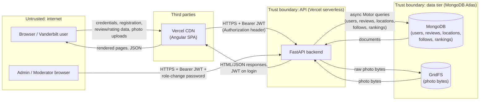

# Threat model -- Group 1 (Beli for Vandy)   (docs/security/threat-model.md)
Last updated: 11/3/2026 · Authors: Ashley Lai, Helen Wu, Terra Jang, Sara Ota · Covers: main @ <commit> + staging <url>

## 1. Data-flow diagram (DFD)

## 2. Assets (what an attacker wants)
| Asset | Where it lives | Why it matters |
|-------|----------------|----------------|
| User accounts / sessions | | |
| Personal data (emails, schedules, ...) | | |
| API keys (LLM, maps, email) | | |
| Money / quota (LLM spend) | | |

## 3. STRIDE table (at least 8 rows, across at least 3 boundaries)
| # | Boundary (A -> B) | STRIDE | Asset | Threat (one sentence) | Existing control | Gap? -> Finding ID |
|---|-------------------|--------|-------|-----------------------|------------------|--------------------|
| T1 | Browser -> API | S | | Someone who obtains another user's JWT could impersonate that user until the token expires. | JWT signature and expiration verification. | Check token revocation and exposure risks; open an issue if controls are insufficient.|
| T2 | Browser -> API | T |  | A user could change the user_id or review ID in a request to try to modify someone else's review. |Backend authentication and review ownership checks reported in current main. | Verify with two test accounts that unauthorized edits/deletes are rejected. |
| T3 | Browser -> API | E | | A regular user could attempt to call an admin moderation endpoint directly instead of using the UI. | Admin authentication and authorization reportedly exist. | Verify that every admin endpoint checks the user's role server-side. |
| T4 | Browser -> API | D | | Repeated login attempts or photo uploads could overwhelm the backend or exhaust storage. | Upload size and photo-count limits. | Check login/upload rate limiting and request limits. |
| T5 | API -> DB | I | | An overly broad account API response could expose private user information to other users. | Account response models and backend data validation. | Inspect account-list endpoints and confirm only intended public fields are returned. |
| T6 | API -> DB | T | | A user could try to attach another user's uploaded photo ID to their review. | Photo ownership validation and authenticated attachment checks. | Test mismatched photo ownership and concurrent attachment behavior. |
| T7 | API -> DB | R | | An administrator could remove or moderate a photo without a reliable record of who performed the action. | Needs verification in current moderation code. | Check whether moderation actions record actor, timestamp, and outcome. |
| T8 | GitHub -> Vercel | | | | | |

## 4. OWASP Top 10:2025 checklist -- owner per category
| Category | Owner | What we checked (where) | Result: pass / finding (ID) / N/A + reason |
|----------|-------|-------------------------|--------------------------------------------|
| A01 Broken Access Control (try changing an ID as another user) | Ashley | | |
| A02 Security Misconfiguration | Ashley | | |
| A03 Software Supply Chain Failures | Helen | | |
| A04 Cryptographic Failures | Sara | | |
| A05 Injection (SQL, XSS, command) | Sara | | |
| A06 Insecure Design | Sara | Terra | |
| A07 Authentication Failures | Terra | | |
| A08 Software or Data Integrity Failures | Helen | | |
| A09 Security Logging & Alerting Failures | Terra | | |
| A10 Mishandling of Exceptional Conditions | Helen | | |

## 5. Top 3 risks and next actions
1.
2.
3.
